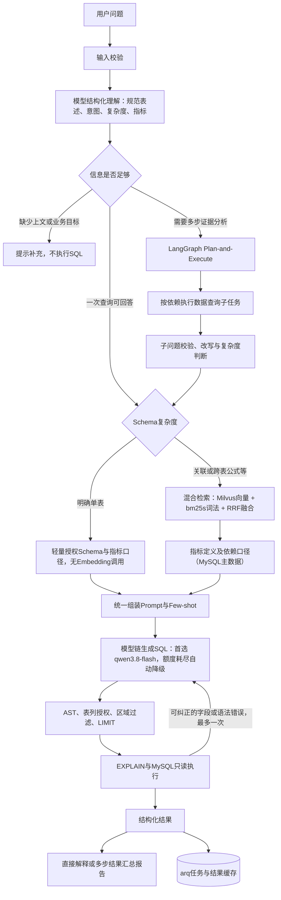

# 当前链路与接手记录

核验日期：2026-09-15（当日第二轮核验）。本文依据运行代码、真实模型调用与测试输出更新；豆包/GPT 交接中的规划不自动视为实现。

## 链路



异步入口与缓存（当前页面默认走这条）：

```
POST /api/jobs → 202 + job_id（同步部分在线程池执行，不阻塞事件循环）
  → arq 队列（Redis）→ worker 并发执行 execute_query → 前端轮询 /api/jobs/{id}
结果缓存键 = 用户 + 权限范围 + 问题 + 模式 + 模型 + prompt版本 + 指标版本
```

- `query` 指一次查询可以回答的问题，不等于简单查询。JOIN、两个独立事实聚合也可以是 `query`，但走复杂 Schema 分支。
- `analysis` 才进入多步计划。子任务复用 `single_query`，不会递归再启动一个分析 Agent。
- 理解器的表、指标选择受服务端权限目录约束；轻量分支注入的字段同样经过权限过滤。最终执行权限仍由 SQL 安全层强制保证。
- 页面统一提交 `mode=auto`。旧API显式 `query/analysis` 仍兼容，但也先做输入理解；不是页面默认行为。
- 当前无多轮会话记忆，不擅自补全“那上个月呢”的指标。理解模型故障时保留原问题，回退完整查询链路，不编造改写。
- 复杂分支为混合检索（向量 + 词法 + RRF），指标口径来自 MySQL 主数据（Redis 60 秒读缓存）。

## 代码对应

| 环节 | 文件 |
|---|---|
| 输入校验、改写、意图、复杂度 | `textile/understanding.py` |
| 轻量Schema、混合Schema Linking | `textile/retrieval.py`、`textile/lexical.py` |
| SQL管线与LangGraph计划/执行/报告 | `textile/agent.py` |
| 指标定义与公式（编写面） | `textile/metric_catalog.py` |
| 指标主数据发布与缓存/Milvus同步 | `scripts/publish_metrics.py`、`textile/registry.py` |
| Prompt规则与Few-shot | `textile/catalog.py` |
| SQL权限与执行 | `textile/security.py`、`textile/db.py` |
| 异步任务、并发限流、结果缓存 | `textile/task_queue.py` |
| 模型链与额度降级 | `textile/models.py`、`textile/telemetry.py` |
| API入口、任务状态 | `textile/app.py` |
| 前端（Vue3 + Element Plus，构建产物） | `frontend/`、`static/portal/` |

## 本轮（2026-09-15 第二轮）实测结果

| 项 | 结果 | 证据 |
|---|---|---|
| 扩展评测 | **40/40，execution_accuracy 1.0**（跨表 FIN-005/FIN-006/INV-005/SAL-008 全通过）；40 例全部由降级模型 `qwen3.8-max-0902` 服务，报告含 `models_used`/`fallback_used`，逐例含 `model`/`fallback` | `artifacts/evaluation-expanded.json`（首选模型基线存档 `evaluation-expanded-before-model-attribution.json`） |
| 混合检索对比 | 向量 recall@4 0.990 / hit@1 0.971；混合 **recall@4 1.000 / hit@1 0.981**（104 例） | `artifacts/retrieval-comparison.json` |
| 并发 20 请求 | admission 最大 **5.219s → 3.125s → 0.266s**（三段修复）；排队中位数 4.13s → **2.22s**；20/20 完成、0 缓存命中 | `artifacts/concurrency-20.json`（修复前基线 `concurrency-20-quota-blocked.json`） |
| 提交延迟（隔离测量，无模型） | 单请求 POST `/api/jobs` 186ms → **49ms**；20 并发最大 2422ms → **493ms**（4.9×） | `scripts/probe_http.py` 输出 |
| 自动化测试 | **58 passed**（10s） | `pytest tests_textile` |
| 指标主数据 | 32 条在 `metric_registry`，Redis 60s 缓存；发布器指纹同步，重复执行不写库 | `scripts/publish_metrics.py` 输出 |
| 向量索引 | 388 条（52 表 + 304 字段 + 32 指标），精确计数校验 | `scripts/ensure_index.py` |
| 账户 | 6 个正式账号 + 用户自建的 `admin_ly`，无测试残留 | `scripts/purge_test_users.py` |
| 模型 | 首选 qwen3.8-flash（`/api/health` 的 `model`/`model_chain`/`model_last_used`） | `artifacts/api.health` 见 VALIDATION.md |

并发修复前基线（同一会话实测，修复后该 artifact 被覆盖）：`maximum_admission_seconds 5.219`、`queue_seconds 7.9–14.8`、admission 中位数约 5.2s。

## 本轮发现并修复的机制缺陷

1. **指标口径改了却不生效**：`migrate_platform.py` 用 `INSERT IGNORE`，指标定义只写第一次，之后任何公式/警戒口径（caveats）修改都留在 Python 里，运行库一直服务旧版本。FIN-006 的跨表警戒就是这么丢的。→ 新增 `scripts/publish_metrics.py`：内容指纹比对 + upsert + 失效 Redis 指标缓存 + 指标文本变化时重建 Milvus 向量；接入 `start-platform.ps1`，重复启动零写入。
2. **跨表指标口径对模型不可读**：跨表指标的"权威计算表达式"是空占位符，模型只能猜，导致用 CROSS JOIN 明细行（笛卡尔积放大分子/分母），FIN-005/FIN-006/SAL-008 相继失败。→ `definition_text()` 改为输出"须先各自独立聚合再用标量子查询组合，严禁 JOIN 明细行"，并在 SQL Prompt 加通用跨表规则；三条跨表指标全部通过。
3. **`ensure_index.py` 用近似值判断索引状态**：`get_collection_stats()['row_count']` 在 upsert 后约为真实值的两倍（未压缩的旧行），会误判索引是否需要重建。→ 新增 `index_count()` 用 `count(*)` 精确计数；文档减少时重建集合，避免检索到已删除口径。
4. **`start/stop-platform.ps1` 在 Windows PowerShell 5.1 下不可用**：用了 PS7 的 `ConvertFrom-Json -AsHashtable`，且脚本含中文注释时被按 GBK 解码导致解析错乱。→ 脚本改为纯 ASCII + CRLF，兼容 5.1；`stop` 增加按命令行匹配的兜底清理。
5. **20 并发提交被串行化**：`async def submit()` 内部全是同步阻塞调用（每次新建 Redis 连接、每次重读 9 个 prompt 源文件、每次新建 arq 连接池），卡住事件循环；`asyncio.to_thread` 默认线程池（8 核 → 12 线程）也承载不了 `max_jobs=20`。→ Redis 客户端单例复用、arq 连接池复用、prompt 版本按内容哈希缓存、改用显式 24 线程 IO 池。实测 admission 5.219s → 0.781s。
6. **评测产物不记录"实际服务模型"**：免费额度按模型独立计量，自动降级时产物仍写首选模型，会把证据归错模型。→ 评测逐例记录 `model`/`fallback`；`/api/health` 增加 `model_last_used`。
7. **`/portal/` 目录根 404**：静态挂载缺 `html=True`（`/` 与 `/app` 正常，直接访问目录路径报 404）。→ 已修，`/portal/`、`/portal/index.html` 均 200。
8. **认证与提交路径每次调用都新建 MySQL 连接**：`app.fetch_user()`（认证）、`task_queue.account()`（权限范围）、`audit()`（审计）各建一条连接，一次提交 3 条；20 并发即约 60 次建连，本机 MySQL 走 Docker 端口转发、单次建连约 40ms 且并发互相争抢，把提交延迟放大到 2.4s。→ 新增 `textile/app_pool.py` 复用现有 `DatabaseConnectionPool`（池 12 + 溢出 8），`_conn()` 改为归还连接池的包装（pymysql 的 `with connection` 只提交/回滚、不关闭连接，不能靠它归还）；同时把 `conn.ping(reconnect=True)` 换成已弃用提示的替代写法。实测 20 并发提交 2422ms → 493ms，20 并发任务 admission 最大 **0.266s**、20/20 完成且 0 缓存命中。并发三段修复的贡献：Redis/arq/prompt 缓存/线程池 → 3.125s，连接池 → 0.266s。
9. **跨表指标修复的端到端复核**：走真实 HTTP + arq 队列问 FIN-006（曾经失败的那条）→ `status=completed`，SQL 为标量子查询形式（无 CROSS JOIN 明细行），返回 `4.760421`，与金标准逐位一致；提交 0.059s、排队 2.36s、执行 12.40s，且**由额度降级后的备选模型服务**（首选 qwen3.8-flash 免费额度当日已耗尽）。说明"定义可读化 + 通用跨表规则"不是只在评测脚本里成立。

## 已知边界（不得外推）

- 40 例评测为**合成功能回归**，不是生产准确率，也不代表企业准确率；样本由本项目的指标口径自动生成。
- **50+ 表（当前 52 张）**已建表、已向量化、可查询；评测只覆盖其中 8 张扩展表（sales_quotes/machine_downtime/goods_receipts/stock_counts/finished_inspections/accounts_receivable/energy_readings/cost_allocations），全表端到端未验证。
- 报告由模型依据结果生成，目前没有程序化逐项数值/因果校验；不得把报告质量等同于 SQL 执行准确率。
- 浏览器端到端本轮**未重跑**：只验证了 HTTP 层（`/`、`/app`、`/portal/` 与前端产物 200）与 API 层真实查询。
- 百炼免费额度**按模型独立计量**且会耗尽：实测 qwen3.7-flash 额度用尽后切到 qwen3.8-flash，本轮又把 3.8-flash 免费额度打满，自动降级到 `qwen3.8-max-0902` 继续完成评测（`artifacts/evaluation-expanded-fallback-quota.json`）。
- 代码改动后需重启 API/worker 才生效（`llm()` 与连接均为进程内单例）；`./start-platform.ps1` 已包含迁移、指标发布、seed、索引检查。
- 项目工作区全部文件仍未提交 git（仅一个 initial commit）。

## 下一阶段

1. A10 收尾：52 张表的端到端抽样查询与权限回归，补多表 join 评测用例。
2. 浏览器端到端复验：Vue3 portal 六个页面 + 岗位差异 + 问数轮询。
3. A9：评测回归自动化（每次 prompt/指标改动自动跑 40 例），并把 `model`/`fallback` 纳入基线比对。
4. 模型额度治理：记录每个模型的免费额度消耗，额度耗尽时告警而非静默降级。

稳定性专项与已取消的 40%/70%→91% 实验不在本轮范围。
