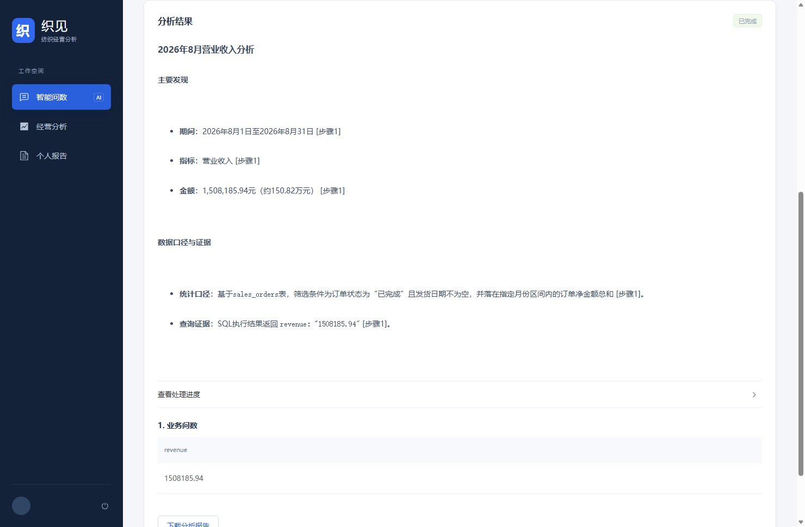
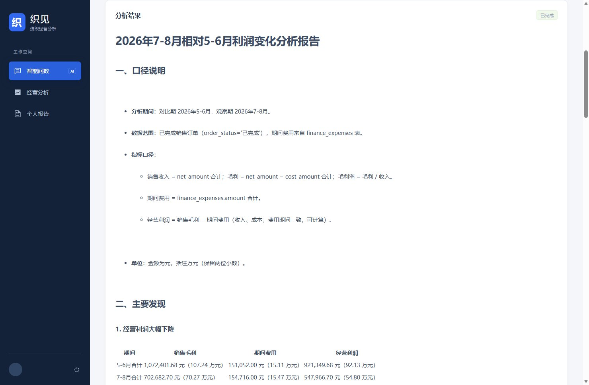
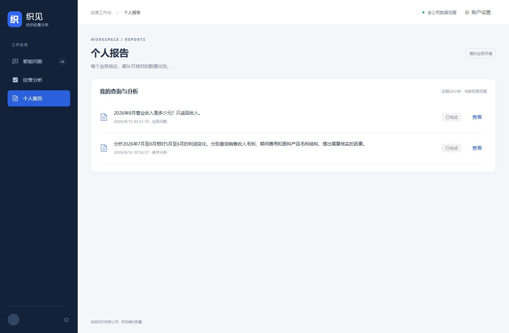
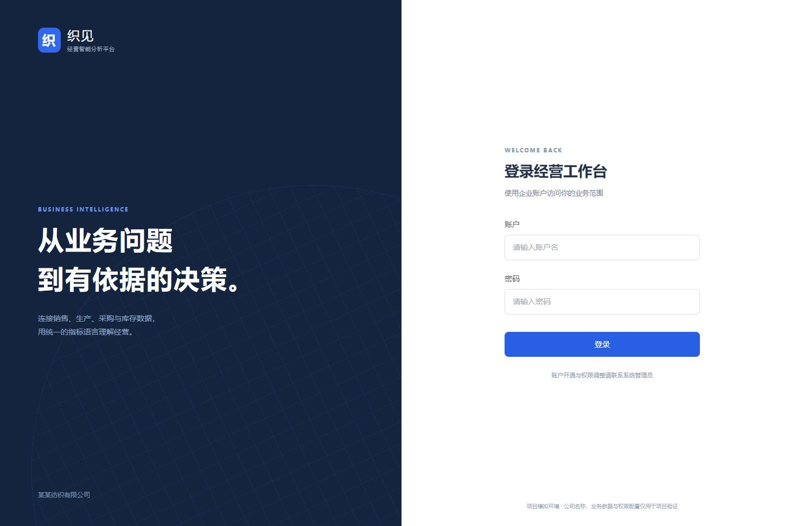
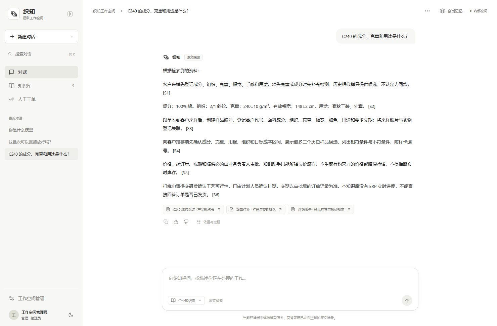
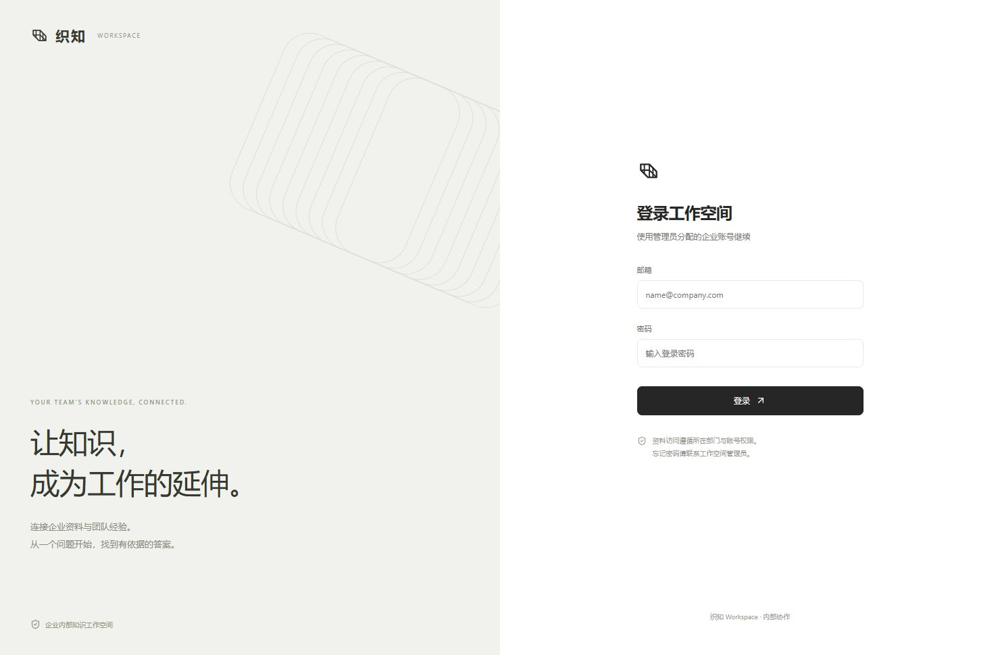

# 李佑毅 · AI 应用作品集

两个个人实践项目，使用样例或公开资料，不代表前雇主的生产系统。

[01 织见：经营数据分析](#chatbi) · [02 织知：面料知识检索](#rag)

---

## 01 织见：经营数据分析

三张功能界面使用原前端回放已保存的模拟运行记录；不是在线查询服务。

### 01　问数：8 月营业收入是多少？

结果为 1,508,185.94 元。页面同时列出期间、订单筛选口径与查询返回值，方便核对。

### 02　分析：两个期间的利润为什么发生变化？

报告先说明收入、成本和期间费用口径，再对比两个期间的毛利、费用和经营利润。

### 03　回看：从个人报告重新打开分析

用两条归档样例回放报告列表，区分单次问数和多步分析。

### 织见 · 经营数据问答登录界面

实际运行截图 · 登录入口

[阅读项目说明与本地启动步骤](https://github.com/Lemon1216yu/textile_insight_agent#readme) · [浏览源码](https://github.com/Lemon1216yu/textile_insight_agent)

---

## 02 织知：面料知识检索

此截图展示检索原文与引用。截图时未连接生成模型，因此不将其描述为模型生成答案。

### 织知工作台显示 C240 面料查询、原文摘录及来源

已保存对话的实际界面 · 当前本机未连接生成模型，展示的是检索原文。

### 织知 · 面料知识检索登录界面

实际运行截图 · 登录入口

[阅读项目说明与本地启动步骤](https://github.com/Lemon1216yu/textile-rag-assistant#readme) · [浏览源码](https://github.com/Lemon1216yu/textile-rag-assistant)

## 如何体验

此页面用于浏览截图与说明，不需要启动本地服务。希望运行项目时，请按各仓库 README 安装依赖、配置模型并启动。127.0.0.1 地址仅在启动服务的本机有效。